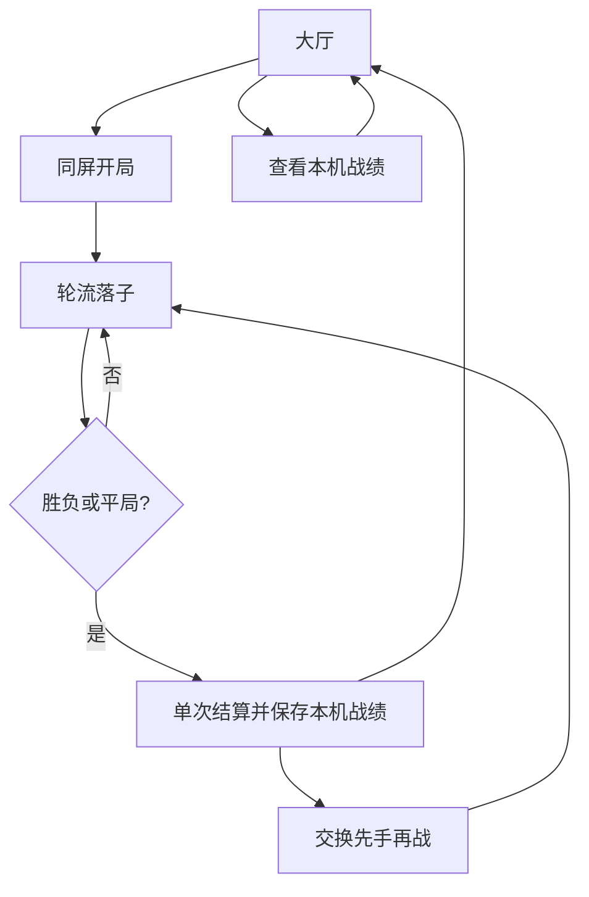

# 双人互动小游戏大全：产品与实施方案

版本：v0.1 / 2026-11-03。定位：情侣与好友随时开一局的轻量微信小游戏合集。当前实现范围及未实现项以 README 和验收记录为准。

## 1. 产品目标与边界

核心体验是「选游戏 → 和身边或远方的人一起玩 → 获得明确结果 → 再来一局」。首版面向愿意共用一台手机的两人；后续支持微信好友远程邀请。先验证两人是否愿意连续玩，再扩充内容数量。名称为工作名称，注册可用性、商标与素材授权需上线前核实。

不在首版加入广告、付费、聊天、陌生人匹配、公开排行榜、用户上传内容。先降低运营和合规复杂度，不作恋爱关系或真实身份判断。使用原创简洁图形，不复制经典游戏的受保护美术、名称或关卡。

## 2. 用户与场景

| 场景 | 用户需求 | 设计响应 |
| --- | --- | --- |
| 情侣等餐、通勤休息 | 几秒开局，输赢轻松 | 无登录大厅、1 分钟内一局、立即再战 |
| 好友聚会 | 规则直观，公平轮流 | 清晰座位颜色与符号、交换先手 |
| 异地好友 | 邀请、等待、断线恢复 | 后续房间码与微信邀请、服务器判定 |
| 想提升成绩 | 看懂什么算最佳 | 每款游戏独立指标、展示口径与数据来源 |

体验原则：不以颜色作为唯一提示；误触后不产生重复结算；进行中退出需确认；存储失败不阻塞游戏。Canvas 的屏幕阅读器支持有限，完整无障碍能力是后续专项。

## 3. 内容与优先级

| 阶段 | 游戏/能力 | 模式 | 最佳战绩口径 | 状态 |
| --- | --- | --- | --- | --- |
| P0 | 井字棋、大厅、结算、设备记录 | 同屏轮流 | 胜场、胜局最少个人落子次数 | 本次实现 |
| P1 | 井字棋房间、好友邀请、身份与云记录 | 远程回合制 | 服务器验证胜场与赛季数据 | 待实现 |
| P2 | 五子棋 | 双人同屏 | 完成局数、平局、黑白胜场 | 已实现，玩法见 README |
| P2 | 翻牌配对 | 2–4 人同屏轮流 | 按人数统计局数、平局和座位胜场 | 已实现，玩法见 README |
| P2 | 四子连珠、点格棋 | 同屏 + 回合制联机 | 胜率/最少步数，规则分别定义 | 候选 |
| P3 | 反应对决、双人乒乓 | 同屏同时操作 | 反应时/得分 | 候选，需多点触控专项 |
| P4 | 实时联网游戏 | 实时联机 | 服务器权威结果 | 网络体验达标后决定 |

井字棋是框架与上线流程的示范，而非长期内容壁垒。不强行为每个游戏共用一种分数：计时游戏取最小值，得分游戏取最大值；各游戏记录规则版本、比较方向及同分策略。跨游戏不做数值相加排行榜。

## 4. 信息架构与页面流程

- 大厅：品牌说明、可玩游戏、模式、时长、入口；未实现内容只显示未来计划，不提供假按钮。
- 游戏页：轮到谁、规则、棋盘、重新开局和返回。
- 结算：胜者或平局、保存状态、交换先手再战、返回大厅。
- 本机战绩：局数、平局、X/O 胜场及最快获胜个人步数。
- 后续房间页：创建/加入、双方到齐、准备、开始、重连、房间解散。

## 5. 井字棋规则与验收

3×3 棋盘，X 首局先手，玩家轮流点击空格；任意横、竖、斜线三个相同符号获胜。九格满且无人获胜为平局。完成后禁止继续落子；再来一局交换先手。中途重开不记录局数，退出回大厅后的新局沿用当前先手设置。

最佳步数统计胜者自己落子次数（3～5），不是整局总步数。记录按设备上的 X/O 座位保存，不关联微信身份；交换先手不交换座位，不假设设备由固定两个人使用。此口径只能反映本机娱乐记录，不能用于可信竞技排名。清除应用数据或换设备不会保留这些记录，跨设备合并不在 P0 范围内。

验收：八种胜线均可获胜；平局成立；越界/重复落子无效；结束后仅记一次；重开不计分；退出确认取消后不丢局；重进能读取已保存记录；损坏记录回退为空；存储失败有明确提示；至少两种手机尺寸可操作。

## 6. 技术方案

选型：原生 JavaScript + Canvas 2D + 微信小游戏 API。无第三方运行依赖、无外部图片或字体请求；P0 无后端、无需登录与网络。相较引擎，适合本阶段小体量回合制小游戏；若后续大量动画、物理或复杂编辑需求，再评估 Cocos 等引擎迁移，不现在增加工具负担。

目录：`src/game.js` 纯规则；`src/records.js` 记录模型；`src/app.js` 页面、输入和绘制；`src/wechat.js` / `browser.js` 平台适配；`scripts/` 构建和预览；`tests/` 规则、UI 集成及平台适配检查；`docs/` 产品与发布资料。

微信和浏览器共用规则与绘制模块。构建脚本将 CommonJS 模块打包为各自入口，不需要 npm 下载。浏览器是调试工具，不能替代微信真机验收。DPR 缩放保持清晰，所有交互使用逻辑坐标。当前采用纵屏、轮流点击，不实现同时操作和实时动画。

后续游戏注册接口建议：`id / title / modes / rulesVersion / create / reduce / result / scorePolicy / render`；五子棋沿用大厅、结算和平台适配，独立处理规则、棋盘绘制和本机战绩。后续扩充游戏时再按共用需求提炼注册表。平台适配继续负责存储、生命周期、分享和网络。

## 7. 联机与云端战绩设计（尚未实现）

优先选微信云开发承载回合制房间、云函数与数据库，部署前验证所选小游戏账号是否具备对应能力、地域和预算；若不可用，采用 HTTPS API + WSS 的独立服务，并配置备案、合法域名和证书。不能把客户端上传的胜负直接当作云端可信记录。

身份：客户端 `wx.login` 获取临时代码，由服务端换取身份；AppSecret 只放服务端安全配置，禁止写入客户端/仓库/聊天。前端不以昵称作为主键，不默认收集头像、手机号或联系人。若采用云开发身份则使用官方提供的认证上下文，禁止信任客户端传入 openid。

建议数据模型：

| 集合 | 主要字段 | 约束 |
| --- | --- | --- |
| players | playerId、createdAt、consentVersion | 最少必要数据，禁止客户端改身份 |
| rooms | roomId、joinCode、gameId、status、seats、expiresAt | 仅两人，加入原子化，码限流 |
| matches | matchId、rulesVersion、roomId、state、revision、result | 服务器负责规则与结果 |
| actions | matchId、actionId、playerId、expectedRevision、move | 幂等键唯一，拒绝过期及越权请求 |
| records | playerId、gameId、rulesVersion、wins、draws、best、updatedAt | 服务端事务更新，不同规则不混排 |

状态机：waiting → ready → playing → finished / expired。掉线进入重连提示，重连时先获取快照与 revision，再补交未确认操作；服务器决定是否已受理。建议初始参数：房间等待 10 分钟过期、掉线宽限 60 秒、回合 60 秒；这些是待真机测试调整的产品参数，不是当前实现行为。

操作接口：创建房间、加入房间、准备、提交落子、取快照、请求再战、离开。每个写请求校验身份、房间成员、状态、回合、版本、频率和输入边界；重复 actionId 返回原结果。双方准备后才开始下一局；再战生成新 matchId。

结算：对局结束事务写结果并更新双方记录，以 matchId 保证只结算一次；断线、超时和主动退出分别定义胜负与记录资格。排行榜仅使用服务器认证记录。本地旧记录标记 local，不自动升级为云端可信数据。房间码可猜测风险需用高熵随机码、有效期和限流控制。

## 8. 交付阶段与依赖

| 阶段 | 交付物 | 完成门槛 | 依赖 |
| --- | --- | --- | --- |
| A 产品与骨架 | 本方案、发布手册、分支、构建 | 文档和命令可复现 | 当前环境 |
| B 同屏首版 | 大厅、井字棋、结算、本机战绩 | 自动测试和浏览器冒烟通过 | 当前环境 |
| C 微信验收 | 真实 AppID 包、体验版 | 开发工具及 iOS/Android 双机清单通过 | 用户注册、开发者工具 |
| D 首次上线 | 隐私及资质材料、审核提交、版本记录 | 平台审核通过、手动发布、线上回归 | 主体资格与平台要求 |
| E 联机内测 | 身份、房间、云端战绩 | 双机重连/并发/越权用例通过 | 云资源及预算 |
| F 内容扩充 | 新游戏、内容目录、运营指标 | 每款游戏独立验收、兼容回归 | 首版反馈 |

先完成 B 再进入 C；C 不通过不提交审核；E 不阻塞同屏首版，但「好友联机」不可在 E 完成前作为已上线能力宣传。暂不承诺审核或资质办理时长。

## 9. 质量、安全与运营

自动化：规则终局穷举、记录读写和错误恢复、UI 完整对局、平台适配冒烟、双目标构建。人工：微信开发工具、iOS/Android、窄屏/高 DPR、前后台切换、系统弹窗、误触、重复进入、清存储、断网。联机增加双端并发、断线重连、重复请求、身份伪造、房间码猜测和事务失败。

性能目标（待真机测量）：冷启动可交互 ≤3 秒，触摸反馈 ≤100ms；首包遵守开发工具当前校验限制。P0 不绘制持续动画，仅事件驱动重绘。不可把本机单测速度作为真机性能数据。

P0 不上传行为分析；先通过体验反馈了解开局成功、完成一局与再战意愿。加入埋点后明确事件（game_start/game_finish/rematch/storage_error）、匿名标识、用途、留存期与删除方式，经隐私评估后部署；默认不发送棋盘内容、真实姓名或聊天。

运营建议：先邀请小范围情侣/好友试用，记录能否独立开局、按钮可读性及再战原因。商业化、广告与付费在留存证据和合规能力具备后另立方案。版权、未成年人保护、实名防沉迷和资质要求以账号类型及微信实际审核反馈为准，不能假设独立小游戏天然豁免。

## 10. 当前风险与决策

1. 用户尚无 AppID、主体与开发工具经验：提供逐步手册；阻塞微信发布，不阻塞本地开发。
2. 账号是否允许所选类目、需哪些资质尚未核实：以官方后台反馈决定是否可发布，未通过前不宣传上线时间。
3. 联机增加服务器开销与作弊风险：先回合制服务端权威方案，设置用量告警与费用上限再开放。
4. 本机数据可丢失和被篡改：界面明确标注，不提供公开排名。
5. Canvas 适配可能受微信版本影响：真实 AppID 和双系统真机验收为上线硬门槛。

待用户逐步决策：主体类型与可用资质、正式名称与图标、云开发费用预算、首批体验者；无需一次提供所有答案，不在聊天提交密钥。
